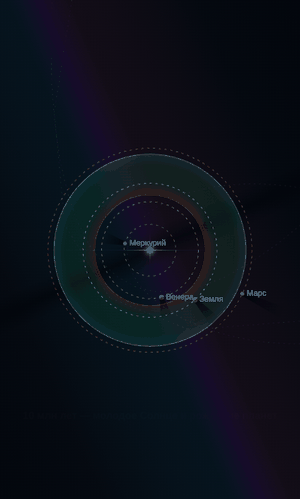
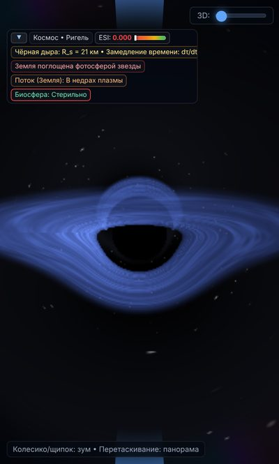
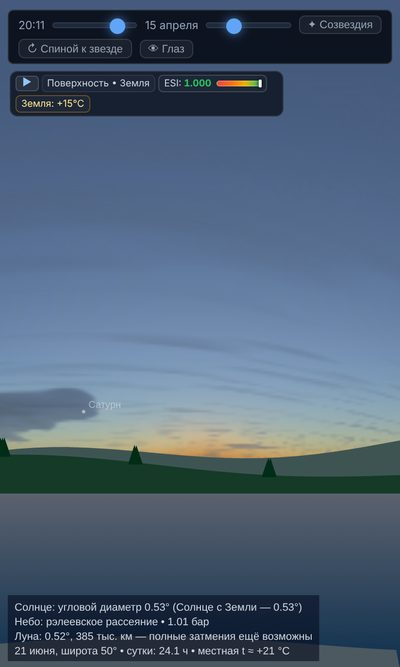
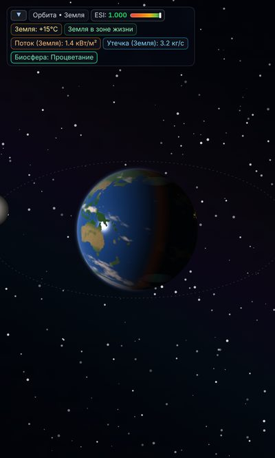
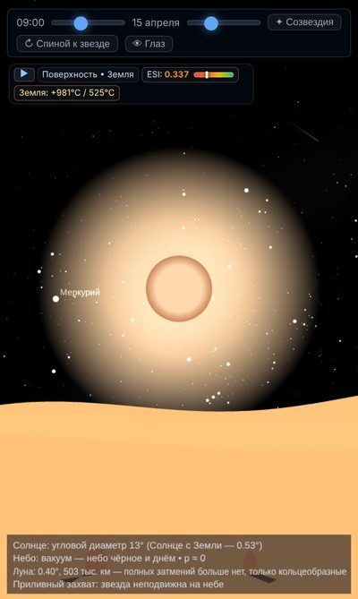
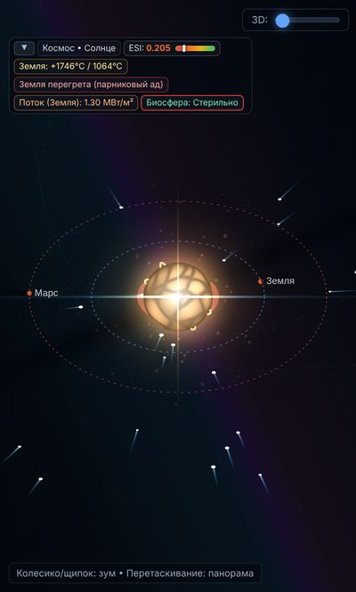
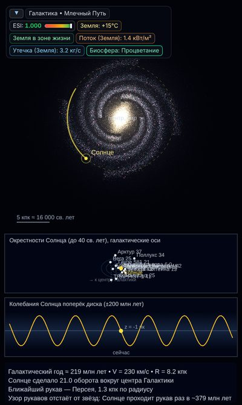
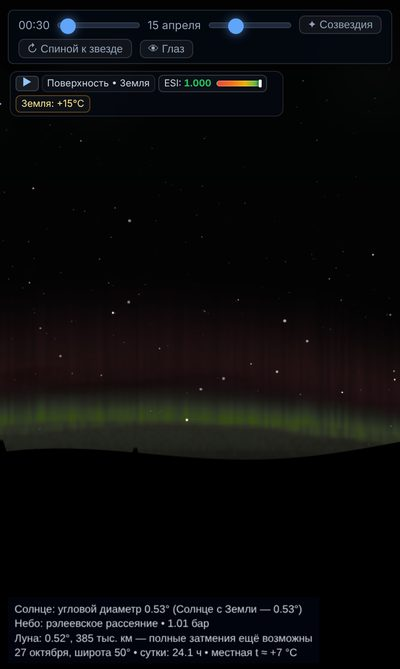
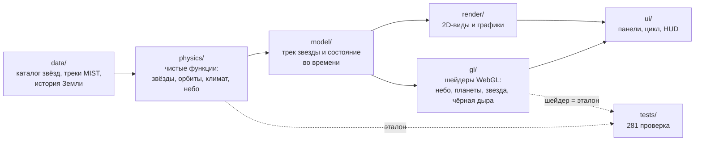
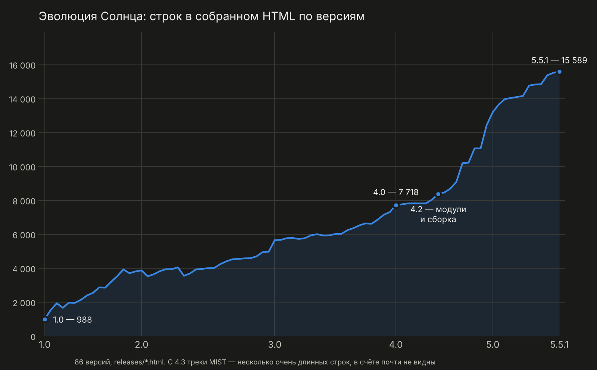

# ☀️ Эволюция Солнца

**Интерактивная симуляция жизни звёзд, планет, климата и неба — от облака газа до чёрного карлика. Физика честная: формулы с источниками, калибровка по реальным данным.**

[](https://github.com/stepka686/sun-evolution/actions/workflows/ci.yml)


[](LICENSE)

### [▶ Открыть в браузере](https://stepka686.github.io/sun-evolution/) · [⬇ Скачать HTML](https://github.com/stepka686/sun-evolution/raw/main/releases/sun_evolution_v5.3.2.html) · [🗂 Все версии](https://stepka686.github.io/sun-evolution/releases/)

Весь проект — один HTML-файл: открывается на телефоне и компьютере, работает без интернета и сервера.

<p align="center"></p>

## Оглавление

- [Что умеет](#что-умеет)
- [Галерея](#галерея)
- [Физика без обмана](#физика-без-обмана)
- [Как устроено](#как-устроено)
- [Разработка](#разработка)
- [История версий](#история-версий)
- [Лицензия](#лицензия)

## Что умеет

- **Звёзды от 0.02 до 300 M☉** по эволюционным трекам MIST с учётом металличности: коричневые карлики, красные карлики, гиганты, сверхгиганты, белые карлики, нейтронные звёзды и чёрные дыры. 32 реальные звезды в каталоге и конструктор своих.
- **Судьба планет из уравнений**: потеря массы звездой, приливы в оболочке гиганта, поглощение, сверхновая. Земля гибнет около 12.1 млрд лет.
- **Климат из энергобаланса**: «снежки», тёплый архей, убегающий парник около 6 млрд лет, атмосферы Марса, Венеры и Титана, оттепели ледяных миров.
- **Небо с поверхности**: спектральная атмосфера в 8 длинах волн, сумерки, тень Земли, облака, радуги и гало, полярные сияния, серебристые облака, корона при затмении, режимы «Глаз» и «Камера».
- **Чёрная дыра** с честной трассировкой лучей на видеокарте: тень, линзирование звёзд, изображение диска над тенью.
- **Режим «Формулы»** — у каждой величины видны формула, подстановка и результат. Ещё в программе: звук звезды (её настоящие колебания), спектр Земли глазами чужого телескопа, Галактика, глубокое время до 10 трлн лет и кинорежим с записью видео.

## Галерея

<table>
<tr>
<td></td>
<td></td>
<td></td>
</tr>
<tr>
<td align="center">Чёрная дыра: тень, кольцо, диск над тенью</td>
<td align="center">Закат: спектральное небо и облака</td>
<td align="center">Земля: шар на видеокарте</td>
</tr>
<tr>
<td></td>
<td></td>
<td></td>
</tr>
<tr>
<td align="center">Солнце-гигант в небе раскалённой Земли</td>
<td align="center">Красный гигант и орбиты планет</td>
<td align="center">Млечный Путь и галактический год</td>
</tr>
</table>

<p align="center"><br>Полярное сияние в магнитную бурю: зелёная и красная линии кислорода на своих высотах</p>

## Физика без обмана

Каждая модель опирается на опубликованную формулу или данные. Если ради красоты что-то преувеличено, это прямо сказано в документации. Главные источники:

- **Звёзды**: треки MIST v1.2 (Choi et al. 2016; Dotter 2016), масса белых карликов (Cummings et al. 2018), радиус вырожденного карлика (Науэнберг), остывание (Местел), звёзды каталога (Pecaut & Mamajek 2013).
- **Планеты и орбиты**: зона жизни (Kopparapu et al. 2013), прилив в конвективной оболочке (Zahn 1977; Villaver & Livio 2009), масса ядра гиганта (Boothroyd & Sackmann 1988), судьба Земли (Schröder & Smith 2008).
- **Климат**: модель Будыко, убегающий парник (Goldblatt et al. 2013), парниковое действие CO₂ (Myhre et al. 1998), история атмосферы Земли по литературным диапазонам.
- **Небо**: функция Чепмена (Schüler 2012), многократное рассеяние (Hillaire 2020), озон и «синий час» (Hulburt 1953), сумерки (Bond & Henderson 1963), рефракция (Сэмундссон), аэрозоль (Kattawar 1975), спектр Земли при транзите (Kaltenegger & Traub 2009).
- **Верхняя атмосфера и Солнце**: линии полярного сияния (Chamberlain 1961; Kivelson & Russell 1995), серебристые облака (Thomas 1996), корона (Баумбах 1937; Людендорф 1928), колебания Солнца (Mosser et al. 2012; Kjeldsen & Bedding 1995).
- **Зрение и релятивистика**: блик в глазу (CIE 146:2002), цвет (CIE 1931), диск чёрной дыры (Shakura & Sunyaev 1973), отклонение света (Эйнштейн 1915).

На формулы смотрят 281 автотест, а шейдеры видеокарты сверяются с эталонными формулами на JavaScript.

## Как устроено



Исходники — ES-модули в `src/`. Сборщик esbuild склеивает их в один самодостаточный HTML. Физика и модель ничего не знают про интерфейс, поэтому тесты гоняются в Node без браузера. Видеокарта рисует в один общий холст. Если WebGL нет, всё рисуется запасным 2D-путём.

## Разработка

Нужен [Node.js](https://nodejs.org) 22 или новее.

```bash
npm install        # сборщик esbuild
npm run dev        # http://localhost:8000
npm test           # тесты физики, ~1 с
npm run build      # dist/sun_evolution_v<версия>.html
```

Подробно об устройстве кода, моделях, их проверке и о каждой версии — в **[docs/DEVELOPMENT.md](docs/DEVELOPMENT.md)**.

## История версий



Проект вырос от 988 строк в 1.0 до ~14 800 в 5.3.2. Все логи и сборки по версиям — в **[docs/HISTORY.md](docs/HISTORY.md)**.

## Лицензия

[MIT](LICENSE): код можно брать, менять и использовать где угодно, сохранив упоминание автора.
