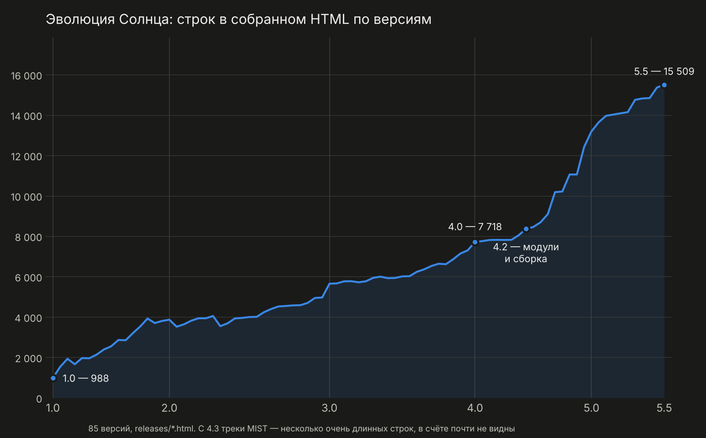

# История версий

От 988 строк в 1.0 до ~14 800 в 5.3.2. Перерисовать после новой версии: `python tools/stats/lines_growth.py` (нужен matplotlib).

Каждая версия — строка: название из лога, сам лог и собранный HTML. Сборки до 4.0.5 переименованы к общему виду `sun_evolution_vX.Y.Z.html`.

| Версия | Что нового | Лог | Сборка |
|---|---|---|---|
| 1.0 | Интерактивная визуализация солнечной системы. | [лог](../changelog/v1.0.txt) | [1.0.0](../releases/sun_evolution_v1.0.0.html) |
| 1.1 | Расширен таймлайн эволюции солнца (-0.05–13 млрд.лет) | [лог](../changelog/v1.1.txt) | [1.1.0](../releases/sun_evolution_v1.1.0.html) |
| 1.2 | Полная переработка логики симуляциис упором на интерактивную обсерваторию | [лог](../changelog/v1.2.txt) | [1.2.0](../releases/sun_evolution_v1.2.0.html) |
| 1.2.1 | НЕРАБОЧАЯ СБОРКА! | [лог](../changelog/v1.2.1.txt) | [1.2.1](../releases/sun_evolution_v1.2.1.html) |
| 1.2.2 | Фикс прошлой нерабочей сборки. | [лог](../changelog/v1.2.2.txt) | [1.2.2](../releases/sun_evolution_v1.2.2.html) |
| 1.2.3 | Полировка обновления | [лог](../changelog/v1.2.3.txt) | [1.2.3](../releases/sun_evolution_v1.2.3.html) |
| 1.3 | Полноценный расчёт температуры для Земли,Марса и Европы | [лог](../changelog/v1.3.txt) | [1.3.0](../releases/sun_evolution_v1.3.0.html) |
| 1.4 | Одно из крупнейших обновлений на данный момент | [лог](../changelog/v1.4.txt) | [1.4.0](../releases/sun_evolution_v1.4.0.html) |
| 1.4.1 | Немного визуальных изменений | [лог](../changelog/v1.4.1.txt) | [1.4.1](../releases/sun_evolution_v1.4.1.html) |
| 1.5 | Новый контент и небольшие визуальные обновления | [лог](../changelog/v1.5.txt) | [1.5.0](../releases/sun_evolution_v1.5.0.html) |
| 1.5.1 | Патч визуальных исправлений | [лог](../changelog/v1.5.1.txt) | [1.5.1](../releases/sun_evolution_v1.5.1.html) |
| 1.6 | Ещё немало нового контента | [лог](../changelog/v1.6.txt) | [1.6.0](../releases/sun_evolution_v1.6.0.html) |
| 1.7 | Достаточно крупное обновление | [лог](../changelog/v1.7.txt) | [1.7.0](../releases/sun_evolution_v1.7.0.html) |
| 1.8 | Немаленькое обновление с упором на биологию и расширение границ. | [лог](../changelog/v1.8.txt) | [1.8.0](../releases/sun_evolution_v1.8.0.html) |
| 1.9 | Подготовка к глобальному ообновлению и полировка первой версии | [лог](../changelog/v1.9.txt) | [1.9.0](../releases/sun_evolution_v1.9.0.html) |
| 1.9.1 | Фикс недоработок интерфейса после переноса кода | [лог](../changelog/v1.9.1.txt) | [1.9.1](../releases/sun_evolution_v1.9.1.html) |
| 2.0 | Крупное физическое обновление | [лог](../changelog/v2.0.txt) | [2.0.0](../releases/sun_evolution_v2.0.0.html) |
| 2.1 | Новый контент,однако нужен срочный фикс! | [лог](../changelog/v2.1.txt) | [2.1.0](../releases/sun_evolution_v2.1.0.html) |
| 2.1.1 | Фиксы критических ошибок после недавнего обновления. | [лог](../changelog/v2.1.1.txt) | [2.1.1](../releases/sun_evolution_v2.1.1.html) |
| 2.1.2 | После недели передышки я вернулся к разработке и фиксам уже наболевших проблем | [лог](../changelog/v2.1.2.txt) | [2.1.2](../releases/sun_evolution_v2.1.2.html) |
| 2.1.3 | Принял решение отполировать сборку,чтобы было проще с ней работать | [лог](../changelog/v2.1.3.txt) | [2.1.3](../releases/sun_evolution_v2.1.3.html) |
| 2.1.4 | Откачиваю проект обратно | [лог](../changelog/v2.1.4.txt) | [2.1.4](../releases/sun_evolution_v2.1.4.html) |
| 2.2 | Мелкое обновление посвящённое стадии зарождения солнца | [лог](../changelog/v2.2.txt) | [2.2.0](../releases/sun_evolution_v2.2.0.html) |
| 2.3 | Перенос кода в новый чат. | [лог](../changelog/v2.3.txt) | [2.3.0](../releases/sun_evolution_v2.3.0.html) |
| 2.4 | Перенос в новый чат прошёл успешно,поэтому новое обновление уже здесь | [лог](../changelog/v2.4.txt) | [2.4.0](../releases/sun_evolution_v2.4.0.html) |
| 2.5 | Переход на инжекторное изменение кода(ЭКСПЕРИМЕНТ!) | [лог](../changelog/v2.5.txt) | [2.5.0](../releases/sun_evolution_v2.5.0.html) |
| 2.5.1 | Снова фиксы | [лог](../changelog/v2.5.1.txt) | [2.5.1](../releases/sun_evolution_v2.5.1.html) |
| 2.5.2 | Продолжаю полировать версию | [лог](../changelog/v2.5.2.txt) | [2.5.2](../releases/sun_evolution_v2.5.2.html) |
| 2.5.3 | Пока без понятия как решить проблему обрезки графиков | [лог](../changelog/v2.5.3.txt) | [2.5.3](../releases/sun_evolution_v2.5.3.html) |
| 2.6 | Немаленькое обновление,однако ему нужно немало доработок | [лог](../changelog/v2.6.txt) | [2.6.0](../releases/sun_evolution_v2.6.0.html) |
| 2.6.1 | Фиксы предыдущего обновления | [лог](../changelog/v2.6.1.txt) | [2.6.1](../releases/sun_evolution_v2.6.1.html) |
| 2.7 | Доработка контента с предыдущего обновления | [лог](../changelog/v2.7.txt) | [2.7.0](../releases/sun_evolution_v2.7.0.html) |
| 2.7.1 | Требуется немало фиксов после обновы | [лог](../changelog/v2.7.1.txt) | [2.7.1](../releases/sun_evolution_v2.7.1.html) |
| 2.7.2 | Доработка эволюции солнца с массой 8.0 | [лог](../changelog/v2.7.2.txt) | [2.7.2](../releases/sun_evolution_v2.7.2.html) |
| 2.7.3 | Дочищаю версию | [лог](../changelog/v2.7.3.txt) | [2.7.3](../releases/sun_evolution_v2.7.3.html) |
| 2.8 | Это обновление ориентированно на доработку новых типов звёзд | [лог](../changelog/v2.8.txt) | [2.8.0](../releases/sun_evolution_v2.8.0.html) |
| 2.9 | Интересное обновление | [лог](../changelog/v2.9.txt) | [2.9.0](../releases/sun_evolution_v2.9.0.html) |
| 2.9.1 | Небольшие исправления и доработки | [лог](../changelog/v2.9.1.txt) | [2.9.1](../releases/sun_evolution_v2.9.1.html) |
| 3.0 | Просто немыслимое по масштабам обновление,поэтому оно разбито на 5 этапов. | [лог](../changelog/v3.0.txt) | [3.0.0](../releases/sun_evolution_v3.0.0.html) |
| 3.0.1 | Начало глобального фикса проблем обновления | [лог](../changelog/v3.0.1.txt) | [3.0.1](../releases/sun_evolution_v3.0.1.html) |
| 3.0.2 | Ещё парочка фиксов | [лог](../changelog/v3.0.2.txt) | [3.0.2](../releases/sun_evolution_v3.0.2.html) |
| 3.0.3 | Ещё исправления | [лог](../changelog/v3.0.3.txt) | [3.0.3](../releases/sun_evolution_v3.0.3.html) |
| 3.0.4 | Перемены в разработке | [лог](../changelog/v3.0.4.txt) | [3.0.4](../releases/sun_evolution_v3.0.4.html) |
| 3.0.5 | Последние исправления версии v3.0 | [лог](../changelog/v3.0.5.txt) | [3.0.5](../releases/sun_evolution_v3.0.5.html) |
| 3.1 | Звезданутое обновление, поэтому разбито на 4 этапа | [лог](../changelog/v3.1.txt) | [3.1.0](../releases/sun_evolution_v3.1.0.html) |
| 3.1.1 | Небольшие правки в симуляции | [лог](../changelog/v3.1.1.txt) | [3.1.1](../releases/sun_evolution_v3.1.1.html) |
| 3.1.2 | Правки звёздной физики | [лог](../changelog/v3.1.2.txt) | [3.1.2](../releases/sun_evolution_v3.1.2.html) |
| 3.1.3 | Ещё поправки | [лог](../changelog/v3.1.3.txt) | [3.1.3](../releases/sun_evolution_v3.1.3.html) |
| 3.2 | Продолжаю обновление звёздной физики. | [лог](../changelog/v3.2.txt) | [3.2.0](../releases/sun_evolution_v3.2.0.html) |
| 3.2.1 | Поправочки | [лог](../changelog/v3.2.1.txt) | [3.2.1](../releases/sun_evolution_v3.2.1.html) |
| 3.3 | Звёздное обновление,скорее всего последнее на время | [лог](../changelog/v3.3.txt) | [3.3.0](../releases/sun_evolution_v3.3.0.html) |
| 3.4 | Первое за долгое время графическое обновление | [лог](../changelog/v3.4.txt) | [3.4.0](../releases/sun_evolution_v3.4.0.html) |
| 3.5 | Завершение гграфического обновления, сборка превысила 300кБ! | [лог](../changelog/v3.5.txt) | [3.5.0](../releases/sun_evolution_v3.5.0.html) |
| 3.6 | Новый контент | [лог](../changelog/v3.6.txt) | [3.6.0](../releases/sun_evolution_v3.6.0.html) |
| 3.6.1 | Техническое обновление и доработка физики | [лог](../changelog/v3.6.1.txt) | [3.6.1](../releases/sun_evolution_v3.6.1.html) |
| 3.7 | Интерактивное обновление и оживление экзопланет | [лог](../changelog/v3.7.txt) | [3.7.0](../releases/sun_evolution_v3.7.0.html) |
| 3.8 | Масштабное расширение звёздной физики и оживление планет | [лог](../changelog/v3.8.txt) | [3.8.0](../releases/sun_evolution_v3.8.0.html) |
| 3.9 | Подготовка к большому обновлению | [лог](../changelog/v3.9.txt) | [3.9.0](../releases/sun_evolution_v3.9.0.html) |
| 4.0–4.0.5 | Юбилейное обновление: Палеоклимат, атмосферы миров и физическая телеметрия СИ(Лог включает изменения для версий v4.0-v4.0.5) | [лог](../changelog/v4.0-v4.0.5.txt) | [4.0.0](../releases/sun_evolution_v4.0.0.html), [4.0.1](../releases/sun_evolution_v4.0.1.html), [4.0.2](../releases/sun_evolution_v4.0.2.html), [4.0.3](../releases/sun_evolution_v4.0.3.html), [4.0.4](../releases/sun_evolution_v4.0.4.html), [4.0.5](../releases/sun_evolution_v4.0.5.html) |
| 4.1 | Физическая ревизия: честная звёздная эволюция и глубокое время | [лог](../changelog/v4.1.txt) | [4.1.0](../releases/sun_evolution_v4.1.0.html) |
| 4.2 | Новая архитектура: модульный проект, сборка и автотесты физики | [лог](../changelog/v4.2.txt) | [4.2.0](../releases/sun_evolution_v4.2.0.html) |
| 4.3 | Настоящие эволюционные треки: звёздная физика по моделям MIST | [лог](../changelog/v4.3.txt) | [4.3.0](../releases/sun_evolution_v4.3.0.html) |
| 4.4 | Судьба планет из уравнений: приливы, потеря массы и гибель Земли | [лог](../changelog/v4.4.txt) | [4.4.0](../releases/sun_evolution_v4.4.0.html) |
| 4.5 | Климат из уравнений: энергобаланс, «снежки» и убегающий парник | [лог](../changelog/v4.5.txt) | [4.5.0](../releases/sun_evolution_v4.5.0.html) |
| 4.6 | Металличность и режим «Формулы» | [лог](../changelog/v4.6.txt) | [4.6.0](../releases/sun_evolution_v4.6.0.html) |
| 4.7 | Графика из физики: небо, поверхность, ночь, планеты, звёзды и кинорежим | [лог](../changelog/v4.7.txt) | [4.7.0](../releases/sun_evolution_v4.7.0.html) |
| 4.7.1 | Настоящие цвета звёзд | [лог](../changelog/v4.7.1.txt) | [4.7.1](../releases/sun_evolution_v4.7.1.html) |
| 4.8 | Земля и небо: планеты-шары, дрейф континентов, звёздное небо и времена года | [лог](../changelog/v4.8.txt) | [4.8.0](../releases/sun_evolution_v4.8.0.html) |
| 4.9 | Оптические чудеса и новые ракурсы: плавная атмосфера, радуги, вид с Луны, недра звёзд и Галактика | [лог](../changelog/v4.9.txt) | [4.9.0](../releases/sun_evolution_v4.9.0.html) |
| 5.0 | Переход на видеокарту: планеты, небо, звёзды и Галактика рисуются шейдерами WebGL | [лог](../changelog/v5.0.txt) | [5.0.0](../releases/sun_evolution_v5.0.0.html) |
| 5.0.1 | срыв и вымерзание атмосфер, адаптация глаза в темноте, вёрстка на телефоне | [лог](../changelog/v5.0.1.txt) | [5.0.1](../releases/sun_evolution_v5.0.1.html) |
| 5.1 | Звук звезды и Земля глазами чужого телескопа | [лог](../changelog/v5.1.txt) | [5.1.0](../releases/sun_evolution_v5.1.0.html) |
| 5.2 | Новое небо: спектральная сферическая атмосфера, облака и глаз наблюдателя | [лог](../changelog/v5.2.txt) | [5.2.0](../releases/sun_evolution_v5.2.0.html) |
| 5.2.1 | небо в разы легче для телефона | [лог](../changelog/v5.2.1.txt) | [5.2.1](../releases/sun_evolution_v5.2.1.html) |
| 5.2.2 | скорость на телефоне | [лог](../changelog/v5.2.2.txt) | [5.2.2](../releases/sun_evolution_v5.2.2.html) |
| 5.3 | Сумерки, сияния и чёрная дыра: верхняя атмосфера, корона, блик в глазу и искривление света | [лог](../changelog/v5.3.txt) | [5.3.0](../releases/sun_evolution_v5.3.0.html) |
| 5.3.1 | Глаз и камера: режим без особенностей зрения, лупа для размера звезды, плавный блик | [лог](../changelog/v5.3.1.txt) | [5.3.1](../releases/sun_evolution_v5.3.1.html) |
| 5.3.2 | Подпись кино внизу, честная экспозиция снега и объёмные тени облаков | [лог](../changelog/v5.3.2.txt) | [5.3.2](../releases/sun_evolution_v5.3.2.html) |
| 5.4 | Андромеда: сближение, пролёт и слияние — или промах, три сценария по измерениям HST и Gaia | [лог](../changelog/v5.4.txt) | [5.4.0](../releases/sun_evolution_v5.4.0.html) |
| 5.5 | Объёмные облака: кучевые башни лучом и веер сумеречных лучей по карте теней | — | [5.5.0](../releases/sun_evolution_v5.5.0.html) |
